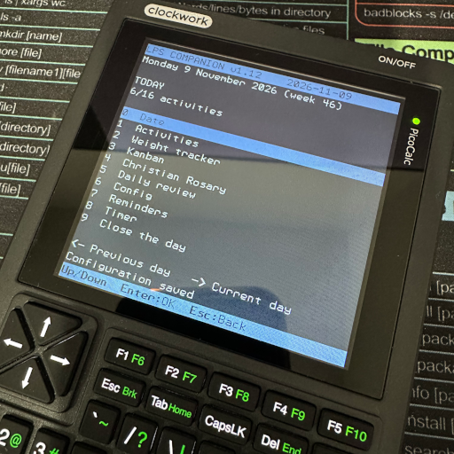

# LPS-Companion v1.13

**A pocket-sized daily activity tracker for the PicoCalc.**



LPS-Companion helps you record daily activities and compare your expected and actual weight.

It runs offline on the original **RP2040 PicoCalc**, with a **320 × 320 display** and physical keyboard. Your entries are saved to the SD card.

**Status:** v1.2 was confirmed working on the user's PicoCalc. v1.14 is in progress (Meal Planner); the title bar still reads v1.13. v1.13 moves the saves to JSON and makes the activity list user-defined (22 by default, up to 30); it needs device testing. See `BUILD-VALIDATION.md` for host checks and physical-test limits.

## Changes in v1.14 (in progress)

- **Meal Planner** (LPS-114-CHG01): a hidden mode for your 24-hour meal cards. Press **Space** on the home menu to open it (there is no menu entry); **Space** or **Esc** returns to the menu. The deck is fixed at 16 cards in three rows, in this order, with duplicates as separate cards:
  - **Drinks / Boissons** (6): Coffee (Latte) / Café (Latte), Coffee (Black) / Café (Noir) ×2, Tea / Thé, Mint Tea / Thé à la menthe, Light Juice / Jus léger.
  - **Food / Nourriture** (8): Light Cheese Wrap / Wrap fromage léger ×2, Tomato Salad / Salade de tomates, Biscuit, Cheese / Fromage, Apple / Pomme, Orange, Soup / Soupe.
  - **Blank** (2): mystery food, nothing to type.
  - One card is shown at a time, drawn as a card: a pastel border in the row colour (blue for drinks, green for food, lavender for Blank), a 32 × 32 pixel-art picture shown at 128 × 128, the name and the portion (for example `1 mug` / `1 tasse`). Above the card: the row and position (`Drinks 1/6`) and the cards left (`11/16 left` / `11/16 restantes`).
  - **Left** / **Right** move between the cards of a row and wrap at the ends. **Up** / **Down** move between the rows (Drinks, Food, Blank) and wrap; the position in the row is kept when the new row is long enough, otherwise the last card is shown.
  - **Enter** plays the card: it turns grey and the header shows its place in the order of play (`PLAYED #3` / `JOUÉE #3`). **Enter** on a grey card puts it back in the deck; the cards played after it move up one place. The PicoCalc has no clock, so the order of play is the only order kept.
  - Each play or put-back is saved at once in `SAVE_A.JSN`/`SAVE_B.JSN`, like an activity tick (`"meals":{"played":[…]}`, deck positions in order of play). The key is optional, so v1.13 saves load with a full deck and the schema version stays 2.
  - The Meal Planner opens on the first card still in the deck. It works on today only; from an archived day, Space shows the read-only message.
  - **New day, new deck**: closing the day (9) deals 16 fresh cards. Played cards are not added to the archive or to the ICS export.
  - The pictures are generated by `tools/meal_sprites.py` into `src/meal_sprites.h` (13 distinct pictures, 4 bits per pixel, 6.7 KB in flash).

## Changes in v1.13

- **Title** (LPS-113-CHG09): the title bar reads `LPS COMPANION v1.13`.
- **JSON save files** (LPS-113-CHG06): the save is now `LPS/SAVE_A.JSN` and `LPS/SAVE_B.JSN`, still written alternately with a generation number and a CRC-32 check, so a damaged or half-written file falls back to the other one exactly as before. The app writes and reads them as a stream with a small hand-written parser (no library, no dynamic memory). The files are managed only by the app; do not edit them by hand.
  - **Migration**: on first start, if there is no `.JSN` save yet, v1.13 reads your existing `SAVE_A.BIN`/`SAVE_B.BIN` (any format from v1.0 to v1.12) and writes `SAVE_A.JSN` at the first save. The `.BIN` files are never modified or deleted and stay on the card as a backup. A save written by v1.13 cannot be read by v1.12.
  - Each day stores its ticked activities **by name** (`"activities":["Marche","Messe"]`, French names) rather than as bit positions, ready for user-defined activities.
  - ICS and CSV exports are unchanged.
- **User-defined activities** (LPS-113-CHG07): you can rename, add, delete and reorder the list from the Activities screen. **E** renames the selected activity, **N** adds one at the end (up to 30), **Del** deletes it after confirmation, **F4** / **F5** move it up or down and wrap at the ends (the same keys as the Kanban, CHG07b). A name is stored only in the language you are using; if the other language has no name, the same name is shown in both. Past days keep the names that were ticked then, so renaming or deleting an activity does not rewrite history or old ICS exports. The default list of 22 is used for a new profile, when loading a v1 JSON save, and when migrating a `.BIN` save.
- **22 activities** (LPS-113-CHG08): six activities are added after the existing 16: **Sport / Sport, Cooking / Cuisine, Chores / Ménage, Family / Famille, Friends / Amis, Meditation / Méditation**. The Activities screen now has three pages (10 + 10 + 2), and the home counter reads `x/22`. The first 16 keep their order, so days from v1.12 saves migrate unchanged. When ticked, the new activities appear by name in the ICS export, with the same format as before. The list is user-defined (CHG07). The Activities screen always opens on page 1 (CHG08b). Number keys 1–9 and 0 act on the current page (CHG08b). Each row is labelled with that key: `1`–`9` for the first nine rows of the page, and `0` for the tenth (CHG08c).

## Changes in v1.12

- **TIMER / MINUTEUR**: keys **1**, **2** and **3** start a duration directly, without Enter (LPS-112-CHG01). On the completion screen they start a new countdown at once; while a countdown runs they are ignored.
- **TIMER / MINUTEUR** now offers **5, 30 or 60 minutes** instead of 5, 15 or 30 (LPS-112-CHG02). A 60-minute countdown starts at `60:00`.
- **No more gamification** (LPS-112-CHG03): XP and keepsakes no longer appear on any screen. Line 1 of every screen now shows the long date and ISO week, for example **Dimanche 8 Novembre 2026 (semaine 45)** / **Sunday 8 November 2026 (week 45)**; it stays blank for undated history. The ICS description keeps an empty `XP:` line so its structure stays compatible with earlier exports; the save format is unchanged.
- **Notepad removed** (LPS-112-CHG05): Kanban and Reminders cover its use. The home menu is renumbered so every entry has a single-key shortcut: **0 Date, 1 Activities, 2 Weight tracker, 3 Kanban, 4 Christian Rosary, 5 Daily review, 6 Config, 7 Reminders, 8 Timer, 9 Close the day**. The archived-day menu becomes **1 Activities, 2 Weight tracker**. A note already present in a save (typed before v1.12) is no longer shown but is still exported to the ICS when its day is closed; the save format is unchanged.

## Changes in v1.11

- **9 TIMER / MINUTEUR** offers 5, 15 or 30 minutes.
- The centred countdown uses 160 × 64 pixels and turns red at **00:59**.
- **Enter** pauses/resumes; **Esc** cancels. At zero, a completion screen remains until acknowledged.
- **10 Close the day / Terminer le jour** is selected with the arrows and **Enter** (or **Up** from the first Home entry).
- The timer uses elapsed monotonic time, requires no SD writes and has no history. Cancelling or restarting discards it.

## Changes in v1.10.2

- The French word **Retour** is normal weight in helper text. The previous/current day hint moves to the next line, and the header date shifts three columns to the right. Home screen status messages remain visible on the line above the day hint.

## Changes in v1.10.1

- **Config → Colors / Couleurs** now offers **PAL4 Orange** and **PAL5 Pink / Rose** alongside red, green, and blue. Up/Down previews; Enter saves, and Esc cancels the preview. New palettes persist in the existing version 6 save format.
- Key names in on-screen hints, including **Enter/Entrée**, **Esc/Échap**, **N**, **Delete/Suppr**, and the arrow keys, use bold character strokes on the PicoCalc display.

## Changes in v1.8

- Added **5 Christian Rosary / Rosaire chrétien** to today's main menu.
- Every new session begins by choosing one of four modes: **one decade (3–5 min)**, **full Rosary (15–20 min)**, **Scripture and short meditations (20–30 min)**, or **slow contemplation (30–40 min)**.
- The app proposes the traditional mysteries for the selected date: Joyful on Monday/Saturday, Sorrowful on Tuesday/Friday, Glorious on Wednesday/Sunday, and Luminous on Thursday. Any cycle can be selected manually.
- One-decade mode asks which of the five mysteries to pray.
- Complete English and French guidance includes the opening prayers, mystery announcements, five decades where applicable, Fatima Prayer, Hail Holy Queen, closing prayer and Sign of the Cross.
- Guided and contemplative modes add a short Scripture passage and meditation for every mystery. Contemplative mode also adds a dedicated silent pause.
- The prayer view displays the current prayer, mystery/decade progress, Hail Mary count and a ten-bead indicator. Long prayers are paginated safely for the 40-column display.
- **Enter/Right** advances, **Left** returns to the previous page or prayer, and **Esc** leaves the session. Rosary progress is intentionally session-only and does not modify saved data.

## Changes in v1.7

- A bold red **`[!] Low battery!`** / **`[!] Batterie faible !`** warning appears when the estimated battery level falls below 20%. Hysteresis prevents flicker near the threshold.
- Added **Lecture / Reading** as activity 15.
- Added **Shopping** as activity 16 in both languages.
- Both activities appear on the second Activities page and are included in XP totals and calendar exports.
- Added a persistent **Kanban** for up to 24 user-defined tasks, each with a 32-character name.
- Tasks move between **TODO / À FAIRE**, **DOING / EN COURS**, and **DONE / FINI** and may be renamed, deleted or reordered.
- Kanban displays contextual key reminders and always opens on TODO / À FAIRE.
- **5 Config** remains unchanged; **Close the day / Terminer le jour** moves to item **6**.

The save format introduced in v1.7 was version 5. Existing version 1–4 saves import with an empty Kanban. Back up the complete SD-card `LPS` directory before updating; older firmware cannot read a save after v1.7 has rewritten it.

## Changes in v1.6

- A cold start without an SD card displays a **bold red** **`[!] Missing SD card!`** warning and blocks writes. English is used because the saved language preference cannot be read while the card is absent.
- Main and selection menus use consecutive rows for a denser, faster-to-scan layout.
- Activities now show **10 entries per page**; Weekend, Sortie/Outing, Jeu/Gaming and Docteur/Doctor appear on the second page.
- ICS descriptions use RFC 5545 newline escapes, so activities, XP, weights and note import as separate lines in calendar applications.

## Changes in v1.5

- **5 Config → 2 Colors / Couleurs** opens a live palette preview. Its labels follow the active language: **red/green/blue/Orange/Pink** in English or **rouge/vert/bleu/Orange/Rose** in French.
- **PAL1** is red/rouge, **PAL2** is green/vert (**default**), and **PAL3** is blue/bleu.
- Use Up/Down or `1`–`5` to preview a palette across the complete interface. Press **Enter** to save it immediately; the full screen is redrawn in the new palette. Esc returns to Configuration without saving the preview.
- Existing v1.4 saves import unchanged and retain the default green palette until a colour is chosen.

## Changes in v1.4

- **0 Date** is a new current-day menu entry in both languages.
- The field is pre-filled as `YYYY-MM-DD`. New profiles begin with the build's suggested date, **2026-09-17**; imported v1.0–v1.3 entries are explicitly undated until you confirm Date.
- The built-in Gregorian calendar covers **2000-01-01 through 2099-12-31**, including leap years. No separate calendar file is needed on the SD card: the rules are compiled into the firmware, so there is no extra file to corrupt or maintain.
- Closing a dated day automatically gives the new day the next valid calendar date.
- Closing a dated day also appends its weight values to `LPS/WEIGHTS/YYYY.csv` on the SD card. The columns are `date,expected_kg,measured_kg`; an unrecorded weight is left blank. Repeating a failed close does not duplicate the date.
- Every successfully closed dated day writes `LPS/EXPORT/YYYY-MM-DD_LPS-Companion.ics` to the SD card. It is a standard all-day calendar event containing activities, an empty `XP:` line, recorded weights, and note.

Closing is blocked until Date is valid. ICS export happens before the A/B snapshot is committed: a failed export leaves the day open and removes its incomplete ICS file. If the snapshot write fails after a successful export, retrying replaces that same date-named export; it never creates a duplicate event.

**Back up the entire SD `LPS` folder before updating.** v1.0–v1.3 cannot read the new format. Old history remains viewable but is marked undated; past entries are never exported retrospectively.

## Changes in v1.3

- **English** is the default for new profiles and imported v1.0–v1.2 saves.
- **5 Config → 1 Language** offers **English** and **Français**.
- Choose a language with Up/Down and Enter (or 1/2), then use **3 Save / 3 Enregistrer** in Configuration. The language takes effect only after a successful save.
- Esc from Language returns to Configuration without selecting the highlighted choice. Esc from Configuration discards unsaved changes.
- Device labels, activity names, help text, errors and keepsake names are translated. Proper names such as Gurumed and user-authored notes remain unchanged.
- The language survives restart and is stored in the protected A/B snapshots alongside your daily data.
- Old saves load automatically without losing activities, notes, weights, XP or history. The first successful save writes format 2, adding one language byte. Mixed old/new snapshots are supported during upgrade.

**Back up the entire SD `LPS` folder before updating.** v1.0–v1.2 cannot read the new format; restore your pre-upgrade backup if downgrading. Fallback to an older v1.2 snapshot also returns the language to English.

## Changes in v1.2

- On the home screen, **Left** steps back one saved day. Press again to go further back, up to the 31 retained completed days.
- On the home screen, **Right** returns directly to the current day.
- Past days are marked **JOUR ARCHIVE - LECTURE SEULE**. Open Activities or Weight to inspect that day's entries. Historical entries cannot be edited or closed again.
- **Esc** returns to the selected day's menu. In Activities, Left/Right still switches activity pages; return to the menu before navigating days.
- The existing save format is unchanged: v1.0/v1.1 history loads automatically. Browsing never writes either save file or awards XP.

## Changes in v1.1

- Repas renamed to **Régime**.
- **Congé** and **Weekend** added.
- The **Pour demain** screen and its navigation removed.
- **Terminer le jour** is now menu item **4**.
- Existing v1.0 saves load without conversion. The previous Repas checkbox becomes Régime; all other existing activity positions are retained.

Back up the SD card’s `LPS` folder before updating. New activity flags are not supported by v1.0; restore your backup if reverting to that version.

## Build

### Requirements

- Original PicoCalc with a Raspberry Pi Pico/Pico H (RP2040).
- FAT16- or FAT32-formatted SD card.
- Linux development computer; the instructions below use Fedora.
- Internet access for the first build to download dependencies.

### Install the Fedora build tools

```bash
sudo dnf install git cmake ninja-build gcc-c++ python3 \
  arm-none-eabi-gcc-cs arm-none-eabi-gcc-cs-c++ arm-none-eabi-newlib
```

### Compile the firmware

Extract the source package, open a terminal in its directory, and run:

```bash
cd LPS-Companion-PicoCalc
bash build.sh
```

The script downloads the pinned dependencies, compiles the application, and checks the generated UF2 file.

**Output:** `build/lps_companion.uf2`

Subsequent builds reuse the downloaded dependencies. To reduce memory usage while compiling:

```bash
LPS_JOBS=2 bash build.sh
```

Build the v1.8 UF2 from the included source using `build.sh`.

## Install

This project produces standalone firmware for **direct BOOTSEL flashing**. Compatibility with UF2 launchers and other Pico modules has not been established.

1. Insert a FAT16/FAT32 SD card into the PicoCalc.
2. Hold the **BOOTSEL** button on the Pico module while connecting the module's USB port to your computer.
3. When the **`RPI-RP2`** drive appears, release BOOTSEL.
4. Copy `build/lps_companion.uf2` onto that drive.
5. The Pico restarts into LPS-Companion.

Use the **Pico module's USB port** for BOOTSEL flashing, rather than assuming the case USB-C port provides it.

Flashing replaces the current Pico firmware, including any installed interpreter or launcher. Keep its UF2 if you want to restore it later. LPS-Companion creates its save directory automatically; no graphics or other asset files need copying to the SD card.

## Usage

### Quick start

1. Open **0 Date**, check or enter the current date, then press Enter.
2. Open **Activities / Activités** and check the activities you have completed.
3. Open **Weight tracker / Suivi du poids** to enter your expected and actual weight.
4. Optionally open **Kanban** to create or update persistent tasks.
5. Optionally open **Christian Rosary / Rosaire chrétien** for a guided prayer session.
6. At the end of the day, choose **9 Close the day / Terminer le jour** and press Enter to confirm. The ICS export is written automatically.
7. The next day begins.

Days advance manually. Leaving the device switched off does not automatically start a new day.

### Main menu

Select the language from Config on today's home screen. Accented French labels are supported.

| Key | English | Français | Purpose |
| --- | --- | --- | --- |
| `0` | Date | Date | Set or correct today's `YYYY-MM-DD` date. |
| `1` | Activities | Activités | Check or uncheck today's activities. |
| `2` | Weight tracker | Suivi du poids | Enter expected and actual weight. |
| `3` | Kanban | Kanban | Manage persistent user-defined tasks. |
| `4` | Christian Rosary | Rosaire chrétien | Start a guided Rosary session. |
| `5` | Daily review | Revue journalière | Show today’s date, selected activities, actual weight, and TODO/DOING tasks. |
| `6` | Config | Config | Choose language or colour palette. |
| `7` | Reminders | Rappels | Create, edit, and delete up to three reminders. |
| `8` | Timer | Minuteur | Start a 5, 30 or 60-minute countdown. |
| `9` | Close the day | Terminer le jour | Save and close today, then advance. |

Use **Up/Down** to select an item, **Enter** to open it, and **Esc** to return to the main menu.

In read-only history, only items 1–3 are available. Press Right on the home screen to return to today before opening Date or Config.

### Reminders / Rappels (v1.10)

Choose **8** to manage a maximum of **three stored reminders**. Press N to create, Up/Down to select, Enter to edit, and Delete to remove one. In the editor, Up/Down switches between **From** (`YYYY-MM-DD`), **Days** (`1–365`), and **Text** (up to 32 ASCII characters); Enter validates and saves. Esc cancels. Edit the prefilled date with Backspace.

Every startup shows **one screen containing all active reminders, one per line**; any key dismisses it for that launch. A reminder starting on October 1 for three days appears October 1–3 and expires October 4. Expired reminders are permanently removed from the SD save on startup, freeing their slots. Future reminders occupy a slot until they expire or are deleted. The app uses its saved **today** date, which advances when you close the day or edit Date; it has no automatic real-time calendar. An SD save failure leaves the old reminder record intact and displays an error. Version 5 saves migrate automatically to version 6 on the next successful write. Back up the SD card's `LPS` folder before installing; older firmware cannot read version 6 saves.

### Daily review / Revue journalière

Choose **6** to see today’s date and actual weight, followed by the selected activities and all global Kanban TODO / DOING tasks. Finished tasks are excluded. Use Up/Down to scroll one line, Left/Right to move eight lines, and Esc to return. Unrecorded weight and empty lists are shown explicitly. The review does not change saved data.

### Christian Rosary

The mode is chosen at the beginning of every new session:

| Mode | Contents | Expected duration |
| --- | --- | --- |
| One decade | One selected mystery and one decade | 3–5 minutes |
| Full Rosary | Five mysteries and prayers | 15–20 minutes |
| Scripture + guidance | Full Rosary, Scripture and short meditations | 20–30 minutes |
| Slow contemplation | Guided Rosary with silent contemplative pauses | 30–40 minutes |

After choosing the mode, accept the proposed mysteries for today's saved date or select Joyful, Luminous, Sorrowful or Glorious manually. One-decade mode then asks for one of the five mysteries.

During prayer, press **Enter** or **Right** to advance. A long prayer may occupy several pages; Enter advances the page before proceeding to the next prayer. Press **Left** to return to the previous page or prayer. **Esc** leaves the current session and returns home.

### Date and calendar

Date accepts exactly `YYYY-MM-DD`, from **2000-01-01** to **2099-12-31**. Press Backspace to edit and Enter to save. It is manual because the base PicoCalc has no dependable real-time clock.

After closing a day, the next date is set automatically, including month/year boundaries and 29 February in leap years. You may correct it through Date before closing the next day. The final supported date, 2099-12-31, cannot be closed because no supported next day exists.

### Activities

Each row is labelled with the key that toggles it on that page (`1`–`9`, and `0` for the tenth row), in the same style as the home menu (`1  Activities`).

**Page 1**

| Key | English | Français |
| --- | --- | --- |
| `1` | Walk | Marche |
| `2` | Diet | Régime |
| `3` | Bible | Bible |
| `4` | Mass | Messe |
| `5` | Work | Travail |
| `6` | Project | Projet |
| `7` | Nap | Sieste |
| `8` | Gurumed | Gurumed |
| `9` | Illness | Maladie |
| `0` | Day off | Congé |

**Page 2**

| Key | English | Français |
| --- | --- | --- |
| `1` | Weekend | Weekend |
| `2` | Outing | Sortie |
| `3` | Gaming | Jeu |
| `4` | Doctor | Docteur |
| `5` | Reading | Lecture |
| `6` | Shopping | Shopping |
| `7` | Sport | Sport |
| `8` | Cooking | Cuisine |
| `9` | Chores | Ménage |
| `0` | Family | Famille |

**Page 3**

| Key | English | Français |
| --- | --- | --- |
| `1` | Friends | Amis |
| `2` | Meditation | Méditation |

Activities are displayed across up to three pages of 10 (the default list is 10 + 10 + 2). Opening the screen from Home or from an archived day always starts on page 1, with the cursor on the first row. **Left/Right** changes page and wraps around; **Up/Down** selects an activity; **Enter** toggles its checkbox. Keys **1–9** toggle rows 1–9 of the page you are on, and **0** toggles row 10 when the page has one. On a short last page, keys that point past the last row are ignored.

On the current day you can also edit the list. Names are limited to 24 letters (the space before the checkbox). An empty name cancels; a duplicate name in the current language is refused. The list holds at most 30 activities. An archived day is read-only: those keys do nothing, and any activity that was ticked that day but later renamed or removed still appears at the end, already checked.

| Key | Action |
| --- | --- |
| `E` | Rename the selected activity (Enter saves, Esc cancels). Only the current language is changed. |
| `N` | Add a new activity at the end (refused at 30). |
| `Del` | Delete the selected activity, after `Confirm? Enter/Esc`. |
| `F4` / `F5` | Move the selected activity up or down, wrapping from first to last and last to first (same keys as the Kanban). |


Each checkbox can be counted once per day. Checking or unchecking an activity saves immediately.

### Kanban

The Kanban is one persistent global board. It is not reset when a day is closed and is not attached to archived days. It holds up to **24 tasks**, with names of up to **32 printable ASCII characters**.

It has three circular columns:

| English | Français | Meaning |
| --- | --- | --- |
| TODO | À FAIRE | Work not started. |
| DOING | EN COURS | Work currently underway. |
| DONE | FINI | Completed work. |

Kanban always opens on **TODO / À FAIRE**. The screen shows the active column, its task count, the selected task, and compact reminders for the available keys.

| Key | Action |
| --- | --- |
| `N` | Create a task in the current column. |
| Left / Right | Move between columns, wrapping at either end. |
| Up / Down | Select the previous or next task, wrapping through the list. |
| Enter | Edit the selected task name. |
| Del | Delete the selected task immediately. |
| `F1` | Move the selected task to TODO / À FAIRE. |
| `F2` | Move the selected task to DOING / EN COURS. |
| `F3` | Move the selected task to DONE / FINI. |
| `F4` | Move the selected task up, wrapping from top to bottom. |
| `F5` | Move the selected task down, wrapping from bottom to top. |
| Esc | Return to the main menu, or cancel name editing. |

New names and every Kanban operation are saved immediately. If a save fails, the previous board remains intact.

### Daily note (removed in v1.12)

The notepad was removed in v1.12; use Kanban or Reminders instead. Notes typed with earlier versions stay in the save file and are still exported to the ICS when their day is closed.

### Weight tracking

The two optional fields are:

- **Expected / Attendu:** expected weight for today.
- **Actual / Effectif:** actual measured weight for today.

Enter values in **kilograms**, using either a decimal point or comma, with up to three decimal places. For example, `110.5` and `110,500` represent the same weight.

Use **Up/Down** or **Tab** to switch fields, **Backspace** to edit, **Enter** to save both fields, and **Esc** to cancel. Leave a field blank when it is not recorded.

The displayed difference is **actual minus expected**. For example, expected `110.5 kg` and actual `111.2 kg` gives `+0.700 kg`.

Expected weight is entered manually. The app does not calculate a diet target or schedule. Both weight fields start empty on the next day.

### XP and keepsakes (removed in v1.12)

Since v1.12 the Companion shows no XP or keepsakes. Earlier saves keep their XP value internally so old and new save files remain compatible, but it is never displayed.

### Finishing the day

Open **Close the day / Terminer le jour** to review the day's activity count. Press **Enter** to confirm or **Esc** to return without closing the day.

Confirmation saves the completed day and clears the activity checkboxes and weight fields for the next day. The following screen confirms the save. Press Enter to continue.

### ICS exports

On closing a dated day, LPS Companion creates:

```text
LPS/EXPORT/YYYY-MM-DD_LPS-Companion.ics
```

For example: `LPS/EXPORT/2026-09-17_LPS-Companion.ics`.

Each file is an iCalendar 2.0 file with one all-day event. It can be copied from the SD card and imported into desktop calendar software. The event description records activities, an empty `XP:` line (kept for compatibility), any weights, and your note. LPS Companion overwrites the same date's export on a retry, so it remains one event per closed day.

## Saved data

LPS-Companion stores data in the SD card's `LPS` directory:

- `SAVE_A.JSN`
- `SAVE_B.JSN`
- `SAVE_A.BIN`, `SAVE_B.BIN`: saves from v1.12 and earlier. Since v1.13 they are only read once, to migrate to JSON, and are left untouched as a backup.

Each file is a complete snapshot of the current day, total XP, retained history, configuration and global Kanban; the two files are not assigned to different days. The app alternates writes between them. At startup it checks both records and loads the highest-generation valid snapshot. If the newest is missing or fails validation, it uses the older intact snapshot, which may lack the latest change. If loading fails due to an I/O error or neither existing record is valid, writes are blocked. A JSON save written by a newer version of the app (a higher `version`) also blocks writes, so it is never overwritten.

Since v1.13 each file is a single JSON object (schema `version` 2 since CHG07; v1 files still load and receive the default list of 22 activities):

```json
{"format":"lps-companion","version":2,"generation":3,
"state":{"language":"en","palette":"green","xp":0,
"activities":[{"id":1,"fr":"Marche","en":"Walk"},{"id":2,"fr":"Messe","en":"Mass"}],
"today":{"date":"2026-09-17","number":1,"activities":["Marche","Bible"],"expected":null,"actual":null,"note":""},
"history":[],
"kanban":[
{"status":"todo","name":"Write \"JSON\" doc"}],
"reminders":[]},
"crc32":"825db3bc"}
```

`generation` increases with every save; the higher valid one wins. `crc32` is the standard CRC-32 (the same as Python's `zlib.crc32`) of every byte before `"crc32"`, and must be the last member. History is stored oldest first. Weights are integer grams, or `null` when not recorded. The top-level `activities` array is the editable list (id plus French and English names). Each day still stores only the names that were ticked that day, so renaming or deleting an activity later does not rewrite past days. Unknown keys are ignored, so later versions can add fields.

Day navigation uses the history from that loaded snapshot in RAM. It indexes backwards from the history ring's next-write position, so the correct day is selected even after the 31 slots wrap. It does not reload the card at every arrow press, switch between A and B to change days, or write while browsing. Back up the **whole `LPS` directory** to preserve your data.

The save contains the language and palette preferences, current date, total XP, global Kanban and the last **31 completed days**. Older completed days are replaced as new days are added. Browse the retained entries with Left on the home screen. The total XP shown remains your current cumulative total; the activity summary shows XP for the selected day.

If saving fails, restart with a working SD card before continuing. A missing, unreadable or corrupt card does not silently become a new saved profile. Avoid removing the SD card while the app is running.

## Current limits

- Battery charge is estimated from RP2040 VSYS voltage; the 20% warning must be calibrated on the physical PicoCalc.
- Date is manually entered; there is no RTC/autonomous clock integration.
- Activities are daily checkboxes, without duration or repetition counts. The list holds at most 30 names of up to 24 letters each.
- Notes support ASCII text only.
- Kanban is limited to 24 tasks; task names support 32 printable ASCII characters.
- Saved history is limited to 31 completed days; earlier days cannot be recovered by browsing. Past days are read-only.
- The current build targets the original RP2040 model.

## Development

| File | Role |
| --- | --- |
| `src/lps_companion.cpp` | Application logic, screens and host tests. |
| `src/main.cpp` | PicoCalc display, keyboard and persistent storage adapter. |
| `src/hw_config.c` | SD-card SPI configuration. |
| `CMakeLists.txt` | Firmware build and memory layout. |
| `build.sh` | Dependency download and compilation. |
| `test.sh` | Application tests and A/B storage integration tests with host files. |
| `tests/json_save_test.cpp` | JSON save writer/parser: round trip, truncation, CRC, unknown keys, escaping and limits. |
| `tests/migration_test.cpp` | Migration of v1.2 and v1.12 binary saves to JSON through the real adapter. |
| `tests/kanban_test.cpp` | Kanban navigation, editing, movement, ordering, rollback and persistence tests. |
| `tests/` | Hardware/FatFs stand-ins used only for host tests of the actual firmware adapter. |
| `verify_uf2.py` | UF2 format, target and address checks. |

Run the application tests on your development computer with:

```bash
bash test.sh
```

Built with the [Raspberry Pi Pico SDK](https://github.com/raspberrypi/pico-sdk), [ClockworkPi PicoCalc drivers](https://github.com/clockworkpi/PicoCalc), and [Carl Kugler's FatFs SPI library](https://github.com/carlk3/no-OS-FatFS-SD-SPI-RPi-Pico). Dependency revisions are pinned in the build configuration; third-party components retain their upstream licensing and notices.
