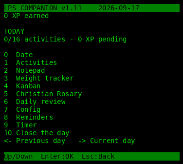

# LPS Companion for MS-DOS

**English** | [Francais](#lps-companion-pour-ms-dos)

A full port of [LPS Companion v1.11](../README.md) (PicoCalc) to real-mode 16-bit MS-DOS
for Intel **8088**-class PCs with **640 KB** conventional memory. Keyboard only
(no mouse). Text mode **80×25** (content laid out in 40 columns, same as the
Companion). Data lives under `C:\LPS\` by default and uses the **same**
`SAVE_A.BIN` / `SAVE_B.BIN`, `EXPORT\*.ics` and `WEIGHTS\*.csv` formats as the
PicoCalc firmware and LPS Console.



## Requirements

- MS-DOS 3.3+ / FreeDOS / MS-DOS 7.x (FAT12/16)
- Intel 8088 or compatible (EXE built with Open Watcom `-0`)
- ~60 KB free disk for `LPSCOMP.EXE`; data folder grows with history
- Colour text (CGA/EGA/VGA) for palettes; mono still readable

## Feature parity (Companion v1.11)

| Feature | Status |
|---|---|
| Date entry (2000–2099) | Yes |
| 16 activities, 2 pages | Yes |
| Notepad 96 chars | Yes |
| Weight expected/measured | Yes |
| Kanban 24 tasks TODO/DOING/DONE | Yes |
| Christian Rosary (4 modes, FR/EN) | Yes (accents ASCII-folded for CP437) |
| Daily review | Yes |
| Config language EN/FR + 5 palettes | Yes (text attributes) |
| 3 reminders | Yes |
| Timer 5/15/30 (BIOS tick) | Yes |
| Close day + XP + 6 keepsakes | Yes |
| 31-day history ←/→ | Yes |
| Dual A/B SAVE + CRC + v1–v6 migrate | Yes (read **and** write) |
| ICS + weights CSV byte-compatible | Yes |

## Build

### DOS EXE (Open Watcom)

```sh
export WATCOM=/path/to/watcom   # this tree used /workspace/lps/tools/watcom
export PATH="$WATCOM/binl64:$PATH"
export INCLUDE="$WATCOM/h"
export LIB="$WATCOM/lib286"
wcl -0 -bt=dos -ms -ox -dLPS_DOS -fe=LPSCOMP.EXE \
  src/state.c src/ics.c src/save.c src/paths.c src/rosary.c \
  src/app.c src/plat_dos.c src/main.c
```

Or: `make dos` (needs `make` and `WATCOM` set).

### Host tests (gcc, no DOS)

```sh
gcc -std=c89 -Isrc -DLPS_HOST -o tests/test_storage \
  tests/test_storage.c src/state.c src/ics.c src/save.c src/paths.c \
  src/rosary.c src/app.c src/plat_host.c
./tests/test_storage
```

## Install on a real machine / DOSBox

1. Copy `LPSCOMP.EXE` to a floppy or the hard disk.
2. Create `C:\LPS` (or pass the path as argv: `LPSCOMP D:\DATA`).
3. Optional: `SET LPSDIR=C:\LPS`
4. Run `LPSCOMP` or `LPSCOMP C:\LPS`.
5. Quit from Home with **Q**.

DOSBox-X / DOSBox Staging example:

```
mount C /path/to/folder/with/LPSCOMP.EXE
C:
LPSCOMP.EXE C:\LPS
```

Use `cputype=8086` (or `8088`) to match the target CPU.

## Keys (same ideas as Companion / LPS Console)

Global: **Up/Down** select, **Enter** confirm, **Esc** back. **Q** quits on Home.

Home digits `0`–`9` open Date / Activities / Note / Weight / Kanban / Rosary /
Daily review / Config / Reminders / Timer; item 10 closes the day.
**Left/Right** browse the last 31 closed days (read-only).

See the PicoCalc README and `console/README.md` in LifePositioningSystem for the
full per-screen binding list; this port follows the same map (F1–F5 on Kanban,
N/Del on Kanban and Reminders, etc.).

## Data layout

```
C:\LPS\
  SAVE_A.BIN     dual-slot snapshots (magic LPR1 + generation + CRC)
  SAVE_B.BIN
  EXPORT\YYYY-MM-DD_LPS-Companion.ics
  WEIGHTS\YYYY.csv
```

Files are interchangeable with the PicoCalc SD card and with LPS Console
imports/exports.

## Source layout

| File | Role |
|---|---|
| `src/state.c` | Dates, XP, encode/decode v1–v6 |
| `src/save.c` | A/B SAVE read/write |
| `src/ics.c` | ICS + weights CSV |
| `src/app.c` | Full UI state machine |
| `src/rosary.c` | Rosary texts and step engine |
| `src/plat_dos.c` | BIOS video/keyboard/timer |
| `src/plat_host.c` | Linux host for tests |

## Captures

Text dumps (and PNG renders) under `captures/` from the host UI driver.
DOSBox was used to boot `LPSCOMP.EXE` on an emulated 8086; graphical grabs
depend on local screenshot tools.

---

# LPS Companion pour MS-DOS

Port complet de LPS Companion v1.11 vers MS-DOS 16 bits (8088, 640 Ko),
clavier uniquement, mode texte 80×25. Memes formats `SAVE_A/B.BIN`, ICS et CSV
que le firmware PicoCalc et LPS Console.

## Compilation

Voir la section **Build** ci-dessus (Open Watcom `-0 -bt=dos -ms`).

## Utilisation

Copier `LPSCOMP.EXE`, creer `C:\LPS`, lancer `LPSCOMP` (ou `LPSCOMP chemin`).
**Q** quitte depuis l'accueil. Les touches reprennent celles du Companion.

## Empreinte

`LPSCOMP.EXE` fait environ **57–60 Ko** (mode small, 8086).

## Ecarts connus

- Accents francais ASCII-ises pour le code page 437 (le sens des chaines est
  conserve ; le Companion PicoCalc garde Latin-1/UTF-8).
- Pas d'avertissement batterie (pas de materiel equivalent).
- Config n'a pas d'entree « import SD » : le disque DOS **est** le stockage.
